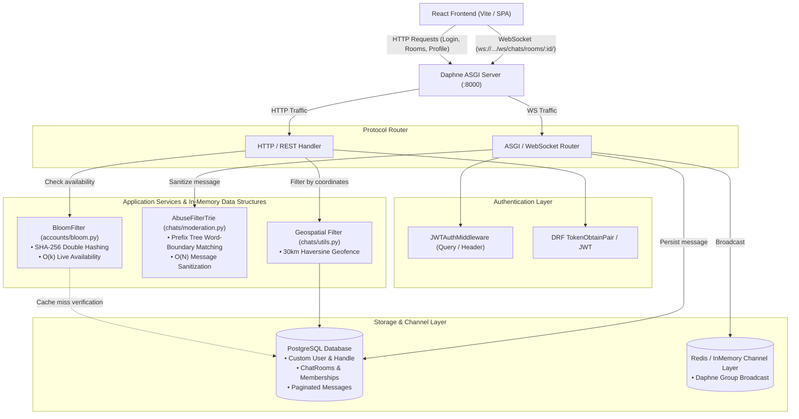

# GeoChat 🌍💬

> Real-time, location-aware chat application powered by Django REST Framework, Daphne ASGI, WebSockets, PostgreSQL, and React.

GeoChat enables users to discover, join, and interact in geofenced chat rooms bounded within configurable geographical radii (defaulting to 30 km). Built with performance-conscious algorithmic primitives, GeoChat integrates an in-memory **Bloom filter** for zero-DB-hit live username availability checking, a pre-compiled **Trie data structure** for $O(\text{message length})$ real-time profanity moderation, and strict transactional integrity for multi-user geofenced room memberships.

---

## 📑 Table of Contents
1. [Core Features](#-core-features)
2. [Algorithmic Highlights & Engineering Decisions](#-algorithmic-highlights--engineering-decisions)
3. [System Architecture](#-system-architecture)
4. [Tech Stack](#-tech-stack)
5. [API & WebSocket Reference](#-api--websocket-reference)
6. [Local Development & Setup](#-local-development--setup)
7. [Running Tests](#-running-tests)
8. [Production Deployment with Docker](#-production-deployment-with-docker)
9. [Future Roadmap](#-future-roadmap)

---

## 🚀 Core Features

- **📍 30 km Geofenced Discovery & Admission:**
  - Chat rooms are tagged with precise geospatial coordinates (`latitude`, `longitude`) and radius boundaries (`radius_km`, default 30.0 km).
  - Uses the spherical **Haversine formula** to filter and sort nearby rooms based on real-time browser/client GPS coordinates (`lat`, `lng`).
  - Strict geofence enforcement: users cannot join rooms outside their configured perimeter unless already an established active member.

- **⚡ Real-Time Full-Duplex WebSockets:**
  - Backed by **Daphne (ASGI)** and **Django Channels 4.x**.
  - Persistent WebSocket connection (`/ws/chats/rooms/<room_id>/?token=<JWT>`) per active chat room for instant broadcast of inbound messages with zero client polling.
  - Custom `JWTAuthMiddleware` dynamically extracts and verifies SimpleJWT tokens from query strings or Authorization headers at handshake time.

- **🔍 Bloom Filter Live Username Availability:**
  - Bit-vector probabilistic lookup with optimal bit sizing ($m$) and double-hashing ($k$ hash positions via SHA-256).
  - Guarantees **zero false negatives**: if the Bloom filter reports a handle as available, it is definitely not taken, avoiding unnecessary database `SELECT` queries while the user types in the profile editor.
  - Self-healing database fallback and `post_save` Django signal integration ensuring immediate synchronization across updates.

- **🛡️ High-Performance Trie Profanity Moderation:**
  - In-memory `AbuseFilterTrie` initialized once on server boot from `chats/data/abusive_words.txt`.
  - Filters and censors abusive substrings inside WebSocket message payloads in $O(N)$ linear time (where $N$ is message character length), replacing prohibited words with asterisks (`****`) before broadcasting to the channel group.

- **🔒 Atomic Concurrency & State Management:**
  - Room creation and auto-membership enrollment wrapped inside `transaction.atomic()` database blocks.
  - Idempotent membership updates (`RoomMembership.objects.get_or_create`) maintaining active/inactive status without duplicate record creation.

---

## 🧠 Algorithmic Highlights & Engineering Decisions

### 1. In-Memory Bloom Filter for Live Username Checks
- **The Problem:** As users type a new handle in the Account Popover, debounced HTTP requests query availability. Naive implementations execute `SELECT EXISTS(SELECT 1 FROM accounts_user WHERE handle = ...)` on every keystroke, subjecting PostgreSQL to connection pool exhaustion and read latency under high traffic.
- **The Solution:** An in-memory Bloom filter ($m = -\frac{n \ln p}{(\ln 2)^2}$, $k = \frac{m}{n} \ln 2$) pre-warmed on server startup.
- **Tradeoff Analysis:**
  - **False Positives vs. False Negatives:** Bloom filters exhibit a bounded false positive rate ($p \approx 0.01$), but **zero false negatives**. If the filter returns `False` (not present), the handle is definitively unused—bypassing the database completely. If it returns `True` (might be present), the system falls back to a targeted PostgreSQL query (`handle__iexact`), ensuring 100% precision without redundant queries for unused handles.

### 2. Prefix Trie vs. Regex for Real-Time Content Moderation
- **The Problem:** In high-concurrency chat channels, compiling and running hundreds of regular expressions or linear substring scans (`if bad_word in message`) on every incoming WebSocket message yields $O(M \times K)$ worst-case time complexity (where $M$ is message length and $K$ is total vocabulary words), degrading Daphne event loops.
- **The Solution:** A specialized Trie structure with word-boundary awareness (`AbuseFilterTrie`) constructed at application boot.
- **Tradeoff Analysis:**
  - Moderating an incoming message scans characters in a single pass ($O(M)$ time complexity), checking character transitions and matching full word tokens against blacklisted terminal nodes. Matches are immediately redacted with asterisks in-place.

### 3. Geofencing via Haversine Formula
- **Implementation:** Real-time distance calculation between point $(lat_1, lon_1)$ and $(lat_2, lon_2)$:
  $$d = 2R \cdot \arcsin\left(\sqrt{\sin^2\left(\frac{\Delta \phi}{2}\right) + \cos(\phi_1)\cos(\phi_2)\sin^2\left(\frac{\Delta \lambda}{2}\right)}\right)$$
  where $R = 6371.0\text{ km}$.
- **Decision:** Avoids heavy PostGIS dependencies for straightforward distance thresholding, maintaining lean deployment constraints while delivering millisecond geospatial filtering.

---

## 🏗️ System Architecture



---

## 💻 Tech Stack

| Category | Technology | Details / Version |
| :--- | :--- | :--- |
| **Backend Framework** | Django / Django REST Framework | Django `5.2.19`, DRF `3.18.3` |
| **ASGI & WebSockets** | Daphne & Django Channels | Daphne `4.2.3`, Channels `4.3.2`, `channels_redis 4.3.0` |
| **Authentication** | Django REST Framework SimpleJWT | PyJWT `2.15.1`, `djangorestframework_simplejwt 5.5.1` |
| **Database** | PostgreSQL | `psycopg2-binary 2.9.13` (Production/Dev), SQLite fallback |
| **In-Memory / Queue** | Redis | `redis 5.3.1` (Backing ChannelLayer in multi-worker environments) |
| **Frontend Framework** | React 18 | `react 18.3.1`, `react-dom 18.3.1` |
| **Build & Tooling** | Vite | `vite 5.4.11`, `@vitejs/plugin-react 4.3.4` |
| **Styling** | Pure CSS3 | Custom Design System, CSS Variables, Responsive Grid / Flex |
| **Testing** | Django Test Runner & Node.js Assert | DRF `APITestCase`, Python `unittest`, Node `node:test` / `assert` |

---

## 🔌 API & WebSocket Reference

### 1. Authentication & Accounts (`/api/`)

| Method | Endpoint | Description | Auth Required |
| :--- | :--- | :--- | :--- |
| `POST` | `/api/token/` | Obtain JWT token pair (`access`, `refresh`) via email/password | No |
| `POST` | `/api/token/refresh/` | Refresh expired JWT access token | No |
| `POST` | `/api/accounts/register/` | Register new user account (`email`, `password`, `mobile_number`, `first_name`, `last_name`, `username`) | No |
| `GET` | `/api/accounts/profile/` | Fetch authenticated user's profile details | Yes (Bearer JWT) |
| `PATCH` | `/api/accounts/profile/` | Update profile fields (`first_name`, `last_name`, `username` handle) | Yes (Bearer JWT) |
| `GET` | `/api/accounts/username-availability/?username=<handle>` | Fast Bloom-filtered handle availability check | No / Yes |

### 2. Chat Rooms & Geofenced Messaging (`/api/chats/`)

| Method | Endpoint | Query Parameters | Description |
| :--- | :--- | :--- | :--- |
| `GET` | `/api/chats/rooms/` | `lat`, `lng`, `radius` (default: 30) | Discover rooms sorted by distance within geospatial radius |
| `POST` | `/api/chats/rooms/` | - | Create a new chat room (`name`, `description`, `latitude`, `longitude`, `radius_km`) |
| `GET` | `/api/chats/rooms/joined/` | - | List rooms the current user has actively joined |
| `GET` | `/api/chats/rooms/<id>/` | `lat`, `lng` (optional) | Retrieve chat room details with calculated distance |
| `POST` | `/api/chats/rooms/<id>/join/` | Body/Query: `lat`, `lng` | Join room with Haversine geofence boundary validation |
| `POST` | `/api/chats/rooms/<id>/leave/` | - | Deactivate room membership |
| `GET` | `/api/chats/rooms/<id>/members/` | - | List active members of the room |
| `GET` | `/api/chats/rooms/<id>/messages/`| `page`, `page_size` | Fetch paginated chat history for active members |
| `POST` | `/api/chats/rooms/<id>/messages/`| - | Send message via REST API fallback |

### 3. Real-Time WebSocket Endpoint

- **URL:** `ws://127.0.0.1:8000/ws/chats/rooms/<room_id>/?token=<JWT_ACCESS_TOKEN>`
- **Handshake Authentication:**
  - Token is verified through `JWTAuthMiddleware`.
  - Unauthenticated connections are closed with code `4001`.
  - Authenticated users without an active `RoomMembership` in the specified room are rejected with code `4003`.
- **Message Payload Format (Client to Server):**
  ```json
  {
    "message": "Hello geochat community!"
  }
  ```
- **Broadcast Payload Format (Server to Client):**
  ```json
  {
    "id": 142,
    "room_id": 3,
    "sender": {
      "id": 12,
      "email": "user@example.com",
      "username": "SilentCipher_50",
      "first_name": "Saurabh",
      "last_name": "Chaubey"
    },
    "content": "Hello geochat community!",
    "created_at": "2026-11-27T05:30:00.000Z"
  }
  ```

---

## 🛠️ Local Development & Setup

### Prerequisites
- Python 3.11 or 3.12
- Node.js (v18+) & npm
- PostgreSQL (or SQLite for development)
- Redis (optional for single-process development; fallback to in-memory channel layer is supported)

### 1. Clone & Environment Configuration
```bash
git clone https://github.com/saurabhchaubey2007-jpg/chat-app.git
cd chat-app
```

### 2. Backend Setup
```bash
# Create and activate virtual environment
python3 -m venv venv
source venv/bin/activate

# Install backend dependencies
pip install -r requirements.txt

# Run migrations
python manage.py migrate

# (Optional) Seed abusive word dictionary if custom list is desired
# chats/data/abusive_words.txt is loaded automatically

# Start Daphne ASGI server
daphne -b 127.0.0.1 -p 8000 core.asgi:application
```

### 3. Frontend Setup
In a new terminal window:
```bash
cd frontend

# Install dependencies
npm install

# Start Vite development server
npm run dev
```
Open [http://localhost:5173](http://localhost:5173) in your browser.

---

## 🧪 Running Tests

Both the backend and frontend include end-to-end and unit test suites covering models, serializers, views, geofencing logic, Trie profanity filtering, Bloom filter mechanics, and UI state reconciliation.

### Backend Test Suite (Django / DRF)
```bash
./venv/bin/python manage.py test
```
*Executes all test cases in `accounts.tests` and `chats.tests` (39 passing test cases verifying account updates, authentication, geofence radius calculations, Bloom filter false-positive handling, and WebSocket authentication).*

### Frontend Test Suite (Node.js Test Runner)
```bash
cd frontend
npm test
```
*Validates room discovery filtering, distance calculation accuracy, message time formatting, and Bloom filter availability debounce/staleness behavior.*

### Frontend Production Build
```bash
cd frontend
npm run build
```

---

## 🐳 Production Deployment with Docker

The repository includes a ready-to-run `docker-compose.yml` defining the backend web container and a healthy Redis instance.

```bash
# Build and run backend and redis services
docker compose up --build -d

# Check service logs
docker compose logs -f web
```

---

## 🗺️ Future Roadmap

- [ ] **PostGIS Spatial Indexing:** Integrate `django.contrib.gis` with PostGIS `ST_DWithin` spatial indices for sub-millisecond query scaling across millions of rooms.
- [ ] **Live Location Tracking:** Dynamic room switching as mobile clients cross geofence boundaries via WebSocket location pings.
- [ ] **Media & Voice Attachments:** Encrypted direct-to-S3 pre-signed media uploads with audio message transcoding.
- [ ] **Distributed Bloom Filter Sync:** Back the in-memory Bloom filter with Redis Bloom (`bf.add` / `bf.exists`) for multi-replica horizontal clustering.
- [ ] **End-to-End Encryption (E2EE):** Signal Protocol double ratchet implementation for geofenced ephemeral rooms.

---

## 📄 License
This project is open-source under the [MIT License](LICENSE).
